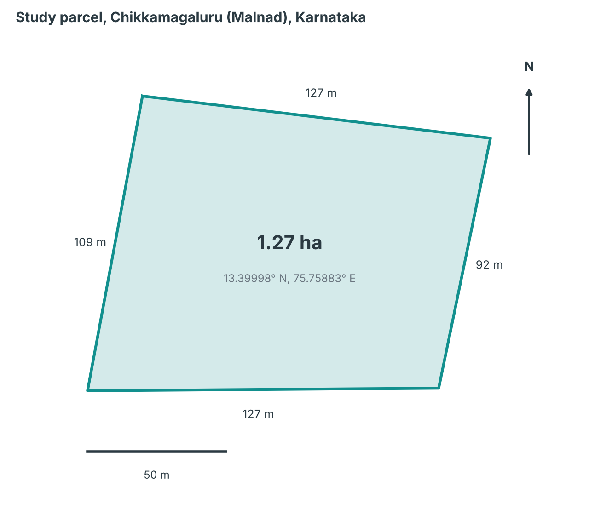
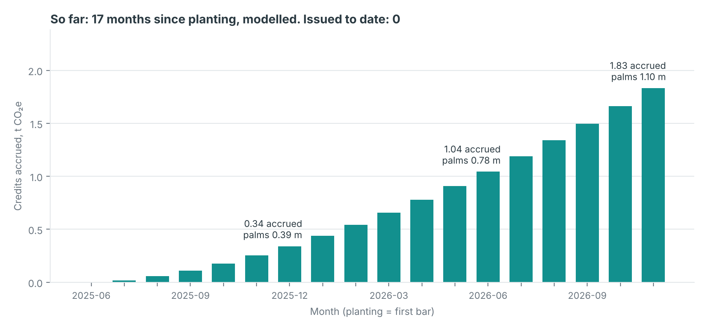
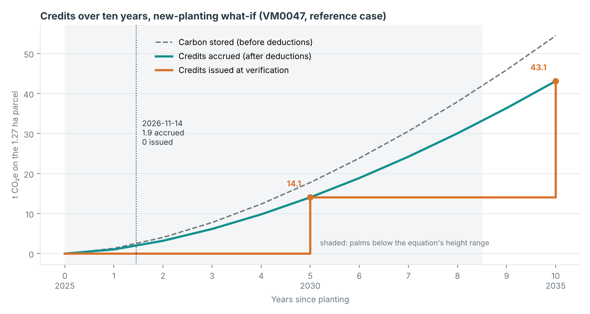
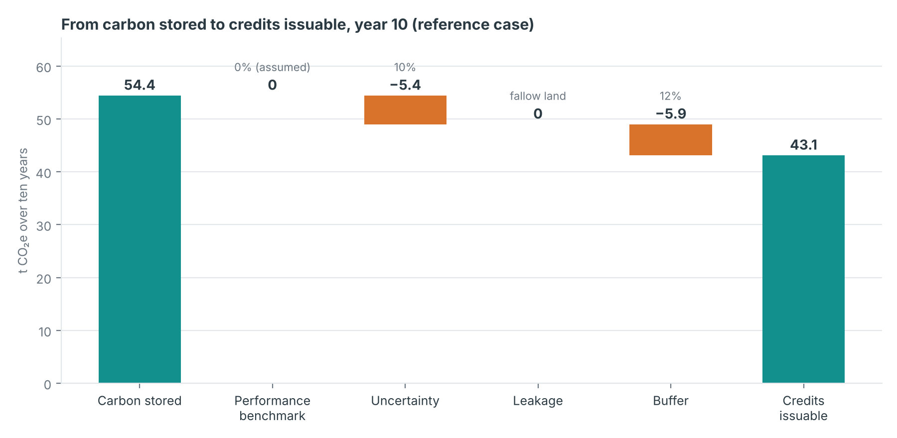
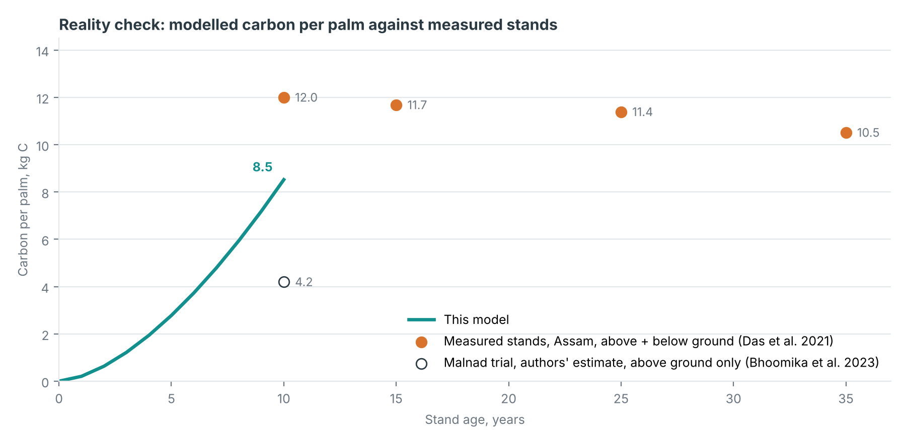
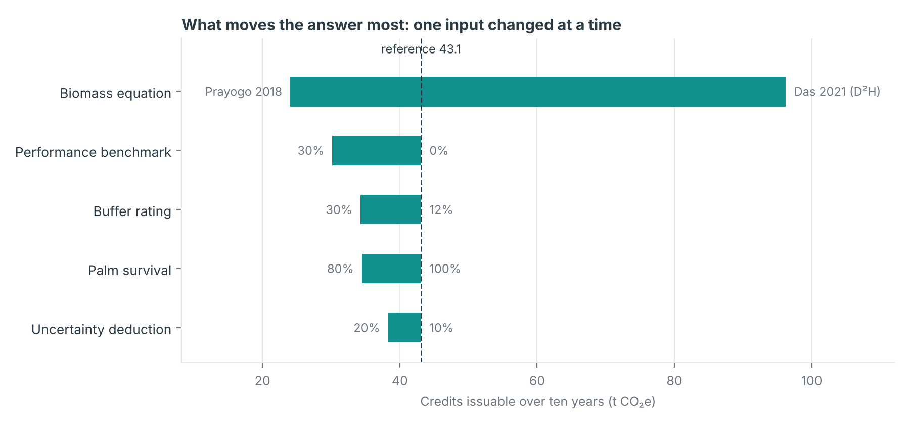

# VM0047 on a real plot: the record so far and the ten-year expectation

A small, tested Python engine that applies Verra's **VM0047 v1.1** rules (Afforestation, Reforestation, and Revegetation) to a planting and reports how many carbon credits it could earn, month by month so far and year by year ahead, with every deduction shown.

It is run on the 1.27 ha parcel from our proof of concept ([mrv-reference-pipeline](https://github.com/satvikkalyanpur/mrv-reference-pipeline), doi:10.5281/zenodo.22026520), treated as a **new arecanut planting** made in June 2025.

> **Scope.** The plot is real; the planting is a what-if. The real plot is an established garden, which VM0047 would not credit as a new project. Tree sizes are measured values from a Malnad field trial, not measurements of this plot. The engine estimates credits; it does not issue them. Only a registry issues credits, after an accredited verifier has checked field measurements.

## The plot



Chikkamagaluru (Malnad), Karnataka, near 13.400° N, 75.759° E. The notebook also shows the boundary on satellite imagery.

One satellite measurement of this plot already exists: mean NDVI 0.873 from Sentinel-2 for November 2024 to March 2025 (proof of concept), which is dense, established canopy. Rainfall and greenness since then can be added with one command; see [Observed record](#observed-record).

## So far: 17 months since planting

1,742 palms at 2.7 m × 2.7 m, transplanted as 12 to 18-month nursery seedlings in the May to June planting season (CPCRI practice).

| Month | Date | Palm height gained | Carbon stored, t CO₂e | Credits accrued | Credits issued |
|---|---|---|---|---|---|
| 0 | Jun 2025 | 0 m | 0 | 0 | 0 |
| 6 | Dec 2025 | 0.39 m | 0.43 | 0.34 | 0 |
| 12 | Jun 2026 | 0.78 m | 1.32 | 1.04 | 0 |
| 17 | Nov 2026 | 1.10 m | 2.31 | 1.83 | 0 |



This is what a young plantation realistically looks like: almost nothing in the first year and a half, and nothing issued until the first verification. These early figures are modelled and indicative, because palms this small are far below the height range of the biomass equation.

## Expected: ten years

| | t CO₂e |
|---|---|
| Carbon stored in palms by year 10 | 54.4 |
| After the 10 % ex-ante uncertainty deduction | 49.0 |
| After the 12 % buffer (lowest the risk tool allows) | **43.1 credits** |

That is **3.4 credits per hectare per year**, issued as 14.1 at the year-5 verification and 29.0 at year 10. It is an upper bound: every deduction is at the lowest value the methodology allows, and the performance benchmark is assumed to be zero. With illustrative mid-range deductions (benchmark 13 %, uncertainty 15 %, buffer 20 %) the figure is 32.2.





## Reality check

Das et al. (2021) measured whole arecanut stands of 10 to 35 years. Their palms hold 10.5 to 12.0 kg of carbon each. The model gives 8.5 kg per palm at year 10, so it sits below what was measured.



## What moves the answer



Three published biomass equations for the same species give 24, 43 and 96 credits. That spread is larger than every deduction combined. The engine uses the Indian height-based equation (Das et al. 2021) because it is the nearest species equation and the only one whose calibration range covers all eight cultivars at age 10. See [docs/CHANGES_FROM_POC.md](docs/CHANGES_FROM_POC.md).

Two findings about where trees go:

- **An existing garden earns nothing.** For dense planting VM0047 credits only growth beyond matched control plots (the performance benchmark). A mature garden grows like its neighbours, so the credited share is zero.
- **Planting on working cropland earns nothing either.** Under VMD0054, displacing the crop from 1.27 ha brings 0.38 ha of new land into production elsewhere. If that land holds more than 35 t C/ha, leakage cancels all ten years of removals. The scenario therefore assumes fallow land.

## Run it

**In Colab:** open [`notebooks/vm0047_exante_arecanut.ipynb`](notebooks/vm0047_exante_arecanut.ipynb) and choose *Runtime → Run all*. No login or Earth Engine project is needed. (The first cell clones this repository; edit `REPO_URL` there if the repository has a different name.)

**Locally:**

```bash
pip install -r requirements.txt
python run.py            # prints the summary, writes outputs/
python -m pytest -q      # 37 checks against hand calculations
```

To try another case, edit `config/scenario_arecanut_newplanting.yaml` (spacing, survival, biomass equation, deductions, start date) and run again.

### Observed record

```bash
python collect_observations.py
```

This fetches monthly rainfall and temperature (NASA POWER) and 16-day NDVI (MODIS, 250 m) for the plot from November 2024 to the as-of date, and saves them in `data/observed/`. Both services are free and need no login. In the notebook, set `COLLECT = True` in section 2 to do the same. The notebook's optional last section adds monthly Sentinel-2 NDVI at 10 m through Earth Engine.

These two collectors have not yet been run against the live services: the parsing is tested, the network calls are not. Run the command once and commit the files.

## What is in the repository

| Path | What it holds |
|---|---|
| `config/vm0047_v1_1.yaml` | The methodology rules, each with its source |
| `config/scenario_arecanut_newplanting.yaml` | The what-if: every line marked CITED, ASSUMED or CHOICE |
| `data/` | Parcel boundary, cited age-10 palm measurements, measured reference stands, observed record |
| `mrv/` | The engine: biomass equations, carbon, uncertainty, performance benchmark, leakage, buffer, credits, eligibility, observed-record collector, hash-chain ledger |
| `tests/` | Unit tests, including the methodology's own worked example |
| `notebooks/` | The Colab walk-through |
| `outputs/` | Tables, figures, summary and ledger from the last run |
| `docs/` | Rule-by-rule map, changes from the proof of concept, assumptions |

## How the calculation works

1. **Approach.** 1,372 palms/ha is far above the 50 planting units/ha limit of the census-based approach, so the area-based approach applies.
2. **Biomass.** Height grows linearly from planting to the measured age-10 height. Total biomass per palm = 1.074 × exp(−0.496 + 1.616 ln H) (Das et al. 2021). 80 % is above ground, 20 % below.
3. **Carbon.** × 0.47 to carbon, × 44/12 to CO₂e, × palms per hectare × area (VM0047 Eqs. 1, 3, 4).
4. **Deductions.** Net removals = stock change × (1 − benchmark) × (1 − uncertainty) − leakage − project emissions (VM0047 Eq. 30). Buffer credits are then withheld.
5. **Issuance.** At verification, every five years at most.
6. **Integrity.** Input files and headline results are chained with SHA-256 in `outputs/ledger.json`.

## What is measured, cited and assumed

| Item | Status |
|---|---|
| Plot boundary and area | Real: the proof-of-concept parcel |
| NDVI 0.873, Nov 2024 to Mar 2025 | Measured on this plot (Sentinel-2, proof of concept) |
| VM0047, VMD0054 and buffer rules | Cited from Verra documents |
| Palm height and diameter at age 10 | Cited: measured at Thirthahalli, Malnad (Bhoomika et al. 2023) |
| Biomass equation and root share | Cited: Das et al. 2021, India |
| Spacing, planting season, seedling age, field stages | Cited: CPCRI package of practices |
| Planting on fallow land in June 2025 | Assumed: this is what makes it a what-if |
| Growth between planting and year 10 | Assumed: linear height growth |
| Palm survival of 100 % | Assumed: no mortality data |
| Performance benchmark of 0 | Assumed: needs satellite control plots |
| Buffer rating of 12 | Floor: a real rating needs the full risk tool |

Full list with the direction of each effect: [docs/ASSUMPTIONS.md](docs/ASSUMPTIONS.md).

### Why arecanut, and why this plot

Other crops were considered. Arecanut is the one crop for which both pieces of evidence could be confirmed: tree sizes measured in the same Malnad zone, and a biomass equation fitted to Indian palms that were cut and weighed, roots included. The plot was kept because its boundary and one satellite measurement already exist.

## What is not done

- No field measurement on the plot and no third-party verification.
- The rainfall and MODIS collectors have not been run against the live services.
- The performance benchmark functions are implemented and tested, but no satellite control plots have been matched; the benchmark is an input.
- Additionality is not shown. Arecanut is a profitable cash crop, which makes the investment test hard to pass.
- Census-based quantification, non-woody pools, soil carbon and project emissions are not implemented.
- Rule numbers follow the VM0047 v1.0 text and Verra's published list of v1.1 changes. Check equation numbers against the v1.1 PDF before quoting them.

Rule-by-rule status: [docs/METHODOLOGY_MAP.md](docs/METHODOLOGY_MAP.md).

## References

- Verra. *VM0047 Afforestation, Reforestation, and Revegetation*, v1.1 (active 14 May 2025). https://verra.org/methodologies/vm0047-afforestation-reforestation-and-revegetation-v1-1/
- Verra. *VMD0054 Estimating Leakage from the Displacement of Agricultural Activities*, v1.1. https://verra.org/methodologies/vmd0054-estimating-leakage-from-the-displacement-of-agricultural-activities-v1-1/
- Verra. *AFOLU Non-Permanence Risk Tool*, v4.2. https://verra.org/documents/afolu-non-permanence-risk-tool-v4-2
- Das, M., Nath, P.C., Sileshi, G.W., Pandey, R., Nath, A.J. and Das, A.K. (2021). Biomass models for estimating carbon storage in Areca palm plantations. *Environmental and Sustainability Indicators* 10: 100115. doi:10.1016/j.indic.2021.100115
- Bhoomika, H.R., Hegde, M.R. and Maheswarappa, H.P. (2023). Productivity and carbon sequestration potential of arecanut cultivars. *Indian Journal of Horticulture* 80(4): 372–376. doi:10.58993/ijh/2023.80.4.11
- Central Plantation Crops Research Institute. *Package of Practices for Arecanut*. Extension Pamphlet No. 2E. Kasaragod, Kerala. https://cpcri.icar.gov.in/filemgr/webfs/publication/pamphlet2e_arecanut.pdf
- Prayogo, C. et al. (2018). Allometric equation for pinang (*Areca catechu*) biomass and C stocks. *AGRIVITA Journal of Agricultural Science* 40(3): 381–389. doi:10.17503/agrivita.v40i3.1124

## Licence

MIT. See `LICENSE`.
